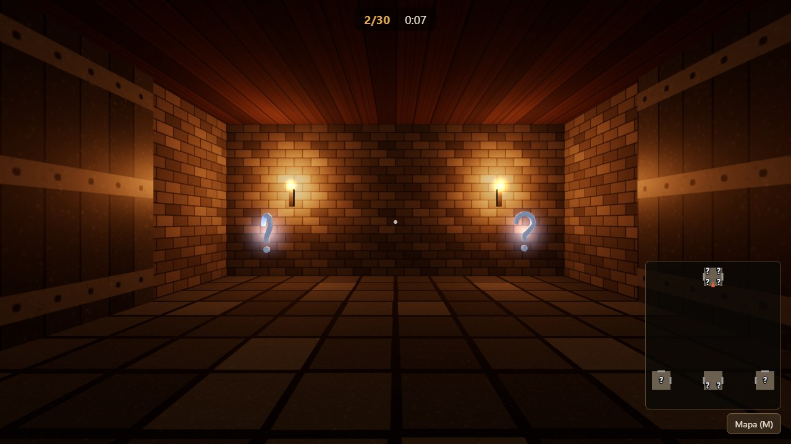

# Kwest

Vzdělávací hra v prohlížeči: projdi hradní bludiště, zodpověz otázky, otevři dveře a najdi východ.

**Hrát online:** https://mykkro.github.io/kwest/



## Vývoj

```bash
npm install
npm run dev        # vývojový server
npm test           # unit testy (Vitest)
npm run e2e        # test v prohlížeči (Playwright; poprvé: npx playwright install chromium)
npm run build      # statický web do dist/
```

## Nasazení

**GitHub Pages (automaticky):** každý push do větve `main` spustí workflow
[.github/workflows/deploy.yml](.github/workflows/deploy.yml), který hru otestuje, sestaví a zveřejní na
https://mykkro.github.io/kwest/. Jednorázové nastavení: v repozitáři *Settings → Pages → Build and deployment →
Source* vyber **GitHub Actions**. Složka `dist/` se do repozitáře neukládá.

**Jiný web:** `npm run build` a obsah složky `dist/` nahraj na libovolný statický web (i do podsložky).
Hra nic neodesílá na server.

## Sady otázek

Viz [docs/otazky.md](docs/otazky.md). Přímý odkaz na sadu: `?test=Z1`.

## Licence a původ

Licence [MIT](LICENSE). Všechny textury, modely a otázky jsou nové, vytvořené pro tento projekt. Složka `legacy/` (původní hra z roku 2006)
slouží jen jako reference, není součástí repozitáře ani buildu.
